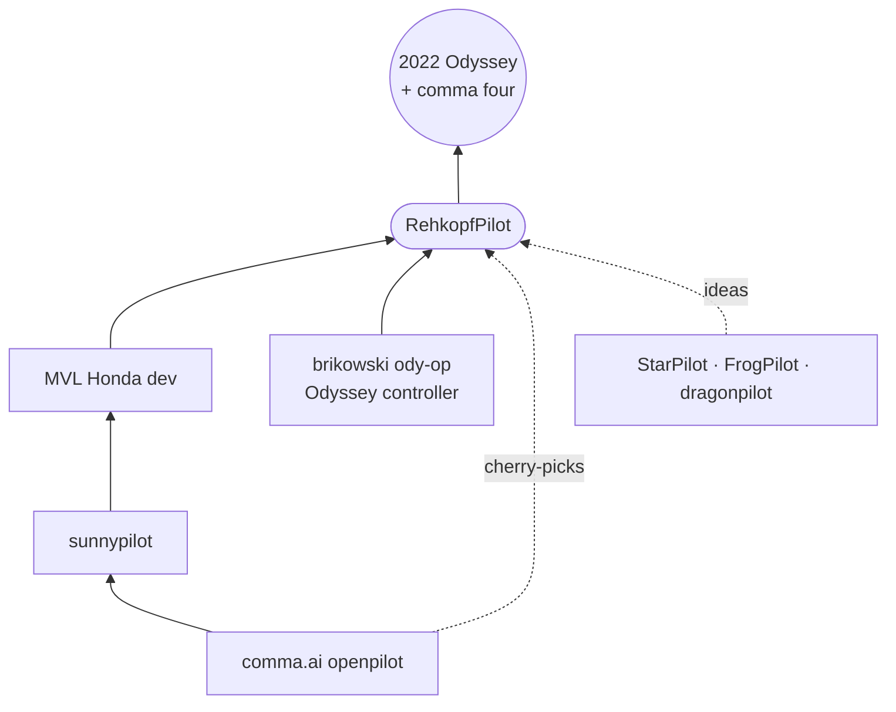
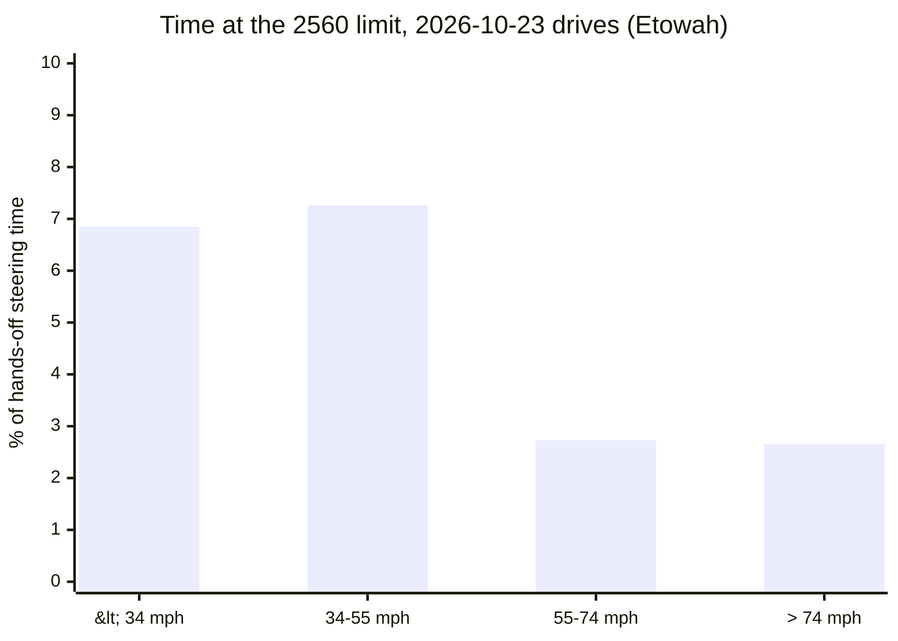

# RehkopfPilot: sunnypilot for the Honda Odyssey

**RehkopfPilot** is my personal build for a **2022 Honda Odyssey** (`HONDA_ODYSSEY_5G_MMR`, Bosch) on a **comma four**, with openpilot longitudinal control. It combines three people's work:

- [**sunnypilot**](https://github.com/sunnypilot/sunnypilot): the feature set (MADS, Dynamic Experimental Control and the rest).
- [**MVL (mvl-boston)**](https://github.com/mvl-boston/openpilot): his Honda dev branch.
- [**brikowski**](https://github.com/brikowski/openpilot): the `ody-op` Odyssey longitudinal and steering tuning.

All three sit on top of [comma.ai's openpilot](https://github.com/commaai/openpilot).

Almost nothing here is mine. My part is merging the three, the Odyssey-specific fixes needed to make them agree, a few comma four screen features, and the testing. Credit for anything that drives well belongs to the people below.

**Docs:** [how it drives](docs/rehkopfpilot/how-it-drives.md) · [navigation without prime](docs/rehkopfpilot/navigation.md) · [how a release is made](docs/rehkopfpilot/release-process.md) · [testing](tools/ody/README.md)

## Credits

| Who | What this build uses |
|---|---|
| [**brikowski**](https://github.com/brikowski) ([openpilot `ody-op`](https://github.com/brikowski/openpilot/tree/ody-op), [opendbc `ody-op`](https://github.com/brikowski/opendbc/tree/ody-op)) | The Odyssey longitudinal controller: gas, brake and coast handling with grade compensation and gas-response feedback. Also the Odyssey steering authority (`STEER_MAX` 3840) with its torque tune, the panda safety limits for Odyssey longitudinal, the fix that stops the set speed jumping to 65 mph on engage, the `longControlState` ordering fix in controlsd, the low-memory branch switch in `op.sh`, and the Odyssey test suite this build's tests are based on. |
| [**MVL (mvl-boston)**](https://github.com/mvl-boston) ([openpilot](https://github.com/mvl-boston/openpilot), [opendbc](https://github.com/mvl-boston/opendbc)) | The Honda dev branch (`sp-honda-dev-202608`) underneath: Honda tuning across the lineup, Honda button handling with all-speed MADS, the torque-map steering, and the branch switcher. This fork mirrors all MVL branches so the switcher can still reach them. |
| [**sunnypilot**](https://github.com/sunnypilot/sunnypilot) | The base: MADS, Dynamic Experimental Control, the settings UI, the model store, and the October 2026 comma sync. |
| [**comma.ai**](https://github.com/commaai/openpilot) | openpilot itself, opendbc and panda. |

If this build is useful to you, the thanks go to them. If you have an Odyssey and want the pure version, run brikowski's `ody-op` directly.

## Branches

| Branch | Status | Install URL |
|---|---|---|
| `ody-next` | My daily driver. Currently **Etowah**, promoted 2026-10-19 after driving it. | `installer.comma.ai/prehkopf/ody-next` |
| `ody-test` | The next release, on test drives before it moves to `ody-next`. Currently **Fayette**. | `installer.comma.ai/prehkopf/ody-test` |
| MVL's branches (`sp-honda-*`, …) | Unchanged mirrors of [mvl-boston/openpilot](https://github.com/mvl-boston/openpilot) | through the branch switcher |

Both branches have a **van load** setting (Empty / Family / Family + luggage) that adds gas for a heavier van; it is still being calibrated on loaded drives.

The matching car code lives in [prehkopf/opendbc](https://github.com/prehkopf/opendbc) on branches of the same names.

## Releases

Each release is named after a place in Georgia, A to Z, and versioned by its release date (`YYYY.MM.DD`, with `.2`, `.3` for later releases the same day). The comma shows the name on the home screen and startup banner, for example "Buckhead • 5c3aa0d", and shows a short "what's new" card after an update.

### Fayette (2026.10.23): on `ody-test`

Etowah plus the first round from the October upstream survey and the 2026-10-23 drive review.

- **Full steering range at every speed.** The Odyssey can now use its full 3840 steering counts at any speed, following brikowski's newer `ody-op-test` (cef93020). Before, the extra range above 2560 opened only at 34-74 mph after the van had missed the curve for 0.2 s, and on the 2026-10-23 drives steering sat at the 2560 limit about 7% of the time below 55 mph. The tune is scaled so ordinary steering asks for the same torque as before; the slew limit is unchanged.
- **Turns on a route aren't lane changes.** On a navigation route, a turn coming up on the blinker side (within about 12 s of travel) counts as a turn, like braking does since Buckhead. It catches the turns taken on the gas: 4 of 34 lane changes on the 2026-10-23 drives started in a real turn at 45-67 mph with no braking. The idea is from StarPilot.
- **Passing and catching up on the highway** (ideas from StarPilot):
  - While you signal out of the lane above 20 mph, the following gap ramps down to 0.75 s so the van accelerates into the pass instead of braking behind the car it is leaving. A car in your blind spot on that side, a lead braking hard, or a stop cancels it.
  - When the car ahead pulls away on the highway and you're below set speed, the van may accelerate up to 0.3 m/s² harder to close the gap. The lead-following plan still holds the gap.
  - All 8 gas overrides on 2026-10-23 were "go faster than the car ahead" at 70-80 mph. A planner replay of 11 highway minutes changes the plan only during the three lane changes, by up to +0.29 m/s².
- **Set speed down without the pause** (comma #39127). Lowering the set speed now slows from where the plan already is, instead of first unwinding the cruise ramp.
- **The comma sleeps 1 hour after a drive** instead of 30, to spare the van battery. It stayed awake 8-9 hours between school runs. Set through the settings profile (v2), so it applies once after the update; change it on the comma or in sunnylink afterwards.
- **comma four touch fixes** (comma #39140-39144): a second finger no longer confuses scrolling, flings and the keyboard.
- **Testing:** a prepush check replays every recorded turn and lane change through the new code; the own-drive replay now covers the planner and fails on a crash; new drive reports (`route_overview.py`, `lane_change_check.py`, `planner_ab.py`). New docs with diagrams under [`docs/rehkopfpilot/`](docs/rehkopfpilot/how-it-drives.md).

### Etowah (2026.10.18.6): on `ody-next`

Dahlonega plus navigation without comma prime (navigation step 1).

- **comma's navigation works without prime.** comma brought back navigation as "nav alpha" on 2026-10-11 (#39066), but without prime comma's servers refuse both routes and map tiles (403). This build gets them elsewhere:
  - **Routes** come from your own free Mapbox token (100,000 requests a month free), kept on the comma and never backed up.
  - **The map** comes from an offline OpenStreetMap file on the comma (the Protomaps basemap; Georgia is 848 MB), so it works without internet.
  - The comma four shows the next turn, the distance to it, a small map, and the ETA.
- **Destination picker** in settings → driving, second after van load. It lists your saved places, which are stored only on the comma. Picking one starts the route and turns navigation on, and the route clears when the car turns off. It's meant for openpilot's route awareness; keep the phone for traffic rerouting.
- **Privacy fixes in comma's navd:**
  - A failed route request no longer logs the request URL, which contained the access token.
  - Route logs no longer include coordinates. Logs upload to comma.
- **Bug fix:** map tiles crashed on sunnypilot's API helper (no `dongle_id`).
- Setup on the comma (token, places, map file) is a one-time script, `qa/nav_setup.sh` in my notes. Nothing personal is in this repo.

### Dahlonega (2026.10.18.5)

Chattahoochee plus a quicker launch from a stop.

- **Green-light launch.** From a stop, the driving model's plan creeps before it commits to moving. Once it plans to be past 2 m/s (4.5 mph) within 3.5 s, openpilot takes the acceleration from the part of the plan where it is already moving: up to 1.5 m/s², fading out by 2 m/s. It never overrides the car ahead: the planner still takes the lowest of the model, lead-following and cruise targets. Ported from comma's unmerged `better-green-lights` branch, gated on Dynamic Experimental Control's model mode.
  - On my drives the plan asked for only 0.13-0.29 m/s² in the second before moving; this asks for 1.44-1.50. Across all 16 pulled drives it would have fired only at the 3 launches with openpilot longitudinal, 7.2 s in total.
- **MADS brake-pause fix** (sunnypilot PR #2031): with steering-on-brake set to Pause, holding the brake from before MADS engaged no longer ends in "take control immediately".
- **Checked and left out:**
  - comma's gentler final-stop ramp (#38658): my 4 openpilot stops already ended gently (-0.06 to -0.27 m/s²).
  - sunnypilot's Honda Brake Hold disengage (#2039): Brake Hold never turned on in 16 drives.

### Chattahoochee (2026.10.18.4)

Buckhead SP1 plus a reorganized settings menu on the comma four.

- **Settings in five groups, most-used first:** driving, software, screen & alerts, privacy, system. Before, options were spread over Toggles, Device, Developer, Software and the sunnylink web app.
- **Driving** starts with **van load**, then personality, Dynamic Experimental Control, lane change, Experimental mode, MADS and enable RehkopfPilot.
- **MADS on/off and lane change mode** (nudge, nudgeless, 0.5-3 s, off) can now be changed on the comma. Before, only the sunnylink web app had them. MADS only changes with the car off, as in sunnypilot.
- Van load and onroad screen moved off the Device page, so nothing appears twice. The metric units button is gone (the setting stays at mph).
- **Software** holds updates & branch, models and sunnylink. **System** holds device, network, developer and firehose. Pairing still opens straight to the pairing card.
- **Testing:** new tests fail if a stock toggle is lost or appears in two groups. The pre-push checklist now builds and renders every settings page.

### Buckhead SP1 (2026.10.18.3)

A service pack: Buckhead plus fixes picked from upstream on 2026-10-18.

- **More gas when the van needs it** (brikowski 6d4b34f8, from his 2026-10-13 stable release). The gas feedback can now use all the gas headroom the map leaves, not just a fixed amount. This should help on hills and pull-aways.
- **No duplicate MADS "can't engage" alerts** (sunnypilot #1949).
- **Smoother steering on engage.** The model starts from the previous curvature while steering is off (comma #39091).
- **GPS startup fixes** (comma #39071, #39083). comma #39079 (start from the last GPS position) is left out: it stores LastGPSPosition in a binary format that sunnypilot's map features (map Smart Cruise Control, map speed limits) cannot read.
- **Steadier timing after a hiccup.** Control loops resync after a stall instead of running catch-up frames (comma #39095).
- **Offroad alert when uploads are being ignored** (comma #39104).
- **Not taken on purpose:** comma 0.11.3 makes Experimental mode ("Auto-speed") permanent and removes Chill mode, and sunnypilot then removed Dynamic Experimental Control. RehkopfPilot keeps DEC.
- **Tests:** an Odyssey downhill test now checks against the Odyssey's own gas-map floor (-0.2) instead of MVL's generic Bosch value.

### Buckhead (2026.10.18.2)

- **Turn vs lane change.** With the blinker on, braking in the last 2 seconds means a turn, not a lane change, so turning the wheel no longer starts a lane change. On replays of my drives, lane changes started at intersections dropped from 19 to 9, and all 12 real lane changes still worked.
- **Status pills** on the comma four: following gap to the car ahead (seconds while moving, feet when stopped), the van load setting, and why Dynamic Experimental Control switched to Experimental (`STOP AHEAD`, `SLOWING`, `CURVE`, `STOPPED`, `COLLISION`).
- **Steering-wheel bookmark.** Double-tap CANCEL to save a bookmark with a chime, so the moment is easy to find in the logs later without reaching for the screen.
- **Dim at night.** An onroad screen option that follows the light down to 10% brightness.
- **Settings profile.** My chosen settings are re-applied after a reinstall or a sunnylink restore (alpha longitudinal, DEC, personality, MADS, screen, updates on).
- **"What's new" card** after an update.
- **Branch switcher: pick the fork, then the branch** (RehkopfPilot, MVL, brikowski, sunnypilot, comma). It only offers branches that exist, and warns before a one-way switch to another fork.
- **Pre-push checklist** (`tools/ody/prepush.sh`) run before every release.
- **Bug fixes & improvements.** sunnylink settings sync no longer drops a text setting the web app sends unencoded.

### Atlanta (2026.10.17)

- **Status pills** on the comma four: `OP LONG` / `STOCK ACC` and `EXP` / `DEC•EXP` / `DEC•ACC`.
- **Dynamic Experimental Control toggle** on the comma four.
- Release codenames and release-date versions.
- **Model runtime fix.** tinygrad is pinned to a version that contains comma's pin, so driver monitoring and the driving model load on the device. Without it, setup stuck on "looking for driver".
- RehkopfPilot branding: home screen, boot logo, startup banner and screensaver.

## Roadmap

These are plans in rough order, not promises. Anything that changes how the van drives waits for enough drive data to tune it and to check the result. Last updated 2026-10-23; the full upstream and fork survey behind it is in my notes.

**Next releases**
- **Gwinnett**
  - Uphill compensation. Holds and gentle slowdowns run about 0.2 m/s² short on grades over 1°.
  - Smarter DEC on the highway: stay in ACC above about 55 mph unless the model sees a stop. dragonpilot's AEM (choose ACC or blended from the model's own throttle probability) is the candidate.
  - Exit slowdown (navigation step 2): slow only for the off-ramp you're taking, never for on-ramps, and not before the ramp splits from the highway. The signal is the comma's route when you're on it, and otherwise your right blinker plus the ramp in the offline map, so it works when you follow Google Maps instead. The same map check can catch turns taken on the gas without a route.
  - brikowski's 2026-10-19 stable, car code only: ECON mode, speed calibration across wheel and transmission speed, gas kept through drivetrain and ECON changes, settled-brake release.
- **After that**
  - Tune the green-light launch from real launches (1 of the ~12 needed so far). Dahlonega asks for up to 1.5 m/s²; lower it if it feels abrupt.
  - Curve speed learned from my own driving (FrogPilot's curve-speed learner): run it offline over my manual driving first and compare with sunnypilot's vision turn-speed control.
  - Learned behavior kept between drives, stored separately for each van load.
  - Van load that suggests itself from how the van accelerates, offered as a pill rather than switched silently.

**Later**
- The rest of a "Georgia traffic" personality: a shorter gap at speed and earlier resume. Fayette did the passing and catch-up parts; check the gas overrides after some highway driving first.
- Gentler braking and a longer gap when the wipers are on (from the car's wiper signal, not an internet weather service).
- Acceleration personality (Sport / Normal / Eco), from sunnypilot's draft #815 and StarPilot's acceleration profiles.
- Lane change: a nudge can override the road-edge block, from sunnypilot #2049.
- Update download progress with speed and time left (sunnypilot #2051/#2052). `ody-test` first, with tests, because a broken updater can strand the device.
- Keep-left / keep-right at forks on a route (StarPilot).

**Investigating**
- An emergency-braking layer to partly make up for the stock collision braking that openpilot longitudinal turns off. `ody-test` only, with safety tests.
- Handling remote start cleanly.
- Delayed logging at the start of a drive, for location privacy at home (dragonpilot).
- An offline lateral fit from my drives (friction, lateral-acceleration factor, delay), like StarPilot's Firestar Lateral Method, to check brikowski's steering tune on this van.

**Watching upstream**
- brikowski's `ody-op-test`: more gas, coast and brake qualification work every day; taken when it reaches his Monday stable.
- comma's opendbc #3165 keeps openpilot accelerating while you press the gas. It changes panda safety for every brand and has no reviews yet, so it waits for comma to merge it.
- comma #39105 would revert AccelBoost (gas taps add a little acceleration in Experimental mode), which this build has. It stays until comma explains the revert.
- comma AGNOS 20.1 (a device OS update), comma's experiments with MADS on openpilot longitudinal (`mads`, `mads2`), calibration hysteresis (#39108), sunnypilot's `laneful-curves` steering work, and sunnypilot's detailed onroad view for the comma four (#1767).
- comma's opendbc cleanups (remove car mass, remove rear steer ratio) and panda safety refactors, with the next sunnypilot sync.

**Decided against, for now**
- comma 0.11.3's permanent Auto-speed. comma removed Chill mode and sunnypilot removed DEC; this build keeps Dynamic Experimental Control and takes upstream fixes by cherry-pick.
- brikowski's automatic personality by speed (standard above 55 mph). My highway overrides ask for a shorter gap, not a longer one; Fayette's StarPilot pieces go the other way.
- A gentler final stop (comma #38658, sunnypilot #2034): openpilot stops on my drives already end gently.
- Disengaging on Honda Brake Hold (sunnypilot #2039): Brake Hold never turned on in 16 drives.
- Bookmark on a distance-button hold: that hold already toggles Experimental mode in sunnypilot. The bookmark stays on double-tap CANCEL, which also cancels cruise.
- Taking FrogPilot, StarPilot, dragonpilot or carrotpilot whole: different bases, and carrotpilot is Hyundai-first with its own safety rules. Ideas are ported one at a time instead.
- Speed-limit-based set speed, trip mode, and an automatic post-drive email (on hold until the garage Wi-Fi is better).

## What's in `ody-next`

The branch is built in this order:

1. sunnypilot's October 2026 comma sync (comma openpilot 2026-10-07).
2. MVL `sp-honda-dev-202608`.
3. comma master 2026-10-11.
4. brikowski's Odyssey controller and fixes, through his 2026-10-13 stable, plus his gas-headroom fix (6d4b34f8).
5. The RehkopfPilot releases Atlanta through Etowah (see [Releases](#releases)), including cherry-picks from comma and sunnypilot listed there.

Odyssey-specific details:

- **Longitudinal.** brikowski's controller replaces the generic Honda Bosch gas and wind learner for the Odyssey only. Every other Honda keeps MVL's behavior.
- **Actuator delay is 0.5 s** on the Odyssey. brikowski's controller is tuned at 0.5 s. MVL uses 0.25 s for Bosch, but a fit of my own drives also puts the van at 0.5 s.
- **Steering.** STEER_MAX is 3840 with delta 2, behind brikowski's steering-authority gate (normally 2560); Fayette on `ody-test` drops the gate. See [Steering limits](#steering-limits-odyssey). Platform flags are `BOSCH_ALT_BRAKE | BOSCH_ALT_RADAR` (safetyParam 259).
- **Experimental mode.** Gas taps add a small, temporary acceleration boost (comma's AccelBoost). This works with Dynamic Experimental Control.
- **comma four screen.** An "onroad screen" picker in settings → screen & alerts: always on, 15 s or 3 min, and dim at night.
- **Kept from comma:** the block on openpilot sending AEB. Stock emergency braking is not available with openpilot longitudinal on Bosch Hondas. openpilot's forward collision warning and hard braking still work.

## Steering limits (Odyssey)

Short version: the Odyssey steers in the range where its steering responds cleanly, and since Fayette the extra range is there whenever the controller asks for it.

| | Normal limit | Highest limit | Torque rise per frame |
|---|---|---|---|
| comma (opendbc, 2026-10) | 2560 | 2560 | 3 |
| MVL `sp-honda-dev-202608` | 4096 | 4096 | 3 |
| brikowski `ody-op` stable 2026-10-19 | 2560 | 2560 | 3 |
| Atlanta – Etowah (brikowski's earlier gate) | 2560 | 3840 at 34-74 mph | 2 (same counts/s as 3 at 2560) |
| **Fayette** (brikowski `ody-op-test` cef93020) | 3840 | 3840 | 2 (same counts/s as 3 at 2560) |

- comma's opendbc caps the Odyssey MMR at 2560, with the note "Odyssey MMR uses up to 2560 for LKA; higher RDM commands are nonlinear and also apply brake drag." Above 2560 the van treats the command like Road Departure Mitigation: the steering response is no longer proportional, and the brakes drag.
- MVL allows the full 4096 at all times. MVL's own code notes that the top end isn't characterized yet.
- brikowski's tune scales `latAccelFactor` up and `friction` down by 3840/2560, so ordinary steering asks for the same counts as the stock range, and the slew limit is the same in counts per second. The extra range only matters when the request saturates.
- brikowski first gated the extra range (Atlanta through Etowah used that gate), reverted it in his 2026-10-19 stable, and on 2026-10-21 brought it back without a gate. Fayette follows the ungated version.
- After a Fayette drive, `tools/ody/drive_report/steer_cap_report.py` should show less time at 2560. Watch for steering faults and brake drag in tight, slow turns.

## Testing

Every release passes the pre-push checklist (`tools/ody/prepush.sh`): a full PC build, the driving and driver-monitoring models loaded and run on the PC, code scans, the openpilot and sunnypilot unit and UI tests, the Honda car and safety tests, and a replay of a recorded Odyssey drive. Changes to car code also pass opendbc's full suite (panda safety, MISRA, about 10,300 car tests) and process replay against a sunnypilot base. Driving changes are replayed against my own Odyssey drives before they go in the van. The methods and scripts are in [`tools/ody/`](tools/ody/README.md).

## ⚠️ Read this first

- This is a personal build, tested on one 2022 Odyssey with a comma four. brikowski develops on a 2023, but I haven't driven any other year on this build.
- openpilot longitudinal on Bosch Hondas is **alpha**. It disables the stock radar, and with it stock ACC and collision mitigation braking.
- You are the driver. Keep your hands ready and your eyes on the road.

## 📊 User Data

By default, sunnypilot uploads driving data to comma servers. You can also see your data through [comma connect](https://connect.comma.ai/).

sunnypilot is open source software, and you're free to turn off data collection.

sunnypilot logs the road-facing camera, CAN, GPS, IMU, magnetometer, thermal sensors, crashes, and operating system logs. The driver-facing camera and microphone are only logged if you explicitly opt in under settings.

By using this software, you understand that use of this software or its related services will generate certain types of user data, which may be logged and stored at the sole discretion of comma. By accepting this agreement, you grant an irrevocable, perpetual, worldwide right to comma for the use of this data.

## Licensing

This fork, like sunnypilot, is released under the [MIT License](LICENSE). It includes original work by sunnypilot, MVL and brikowski, as well as significant portions of code derived from [openpilot by comma.ai](https://github.com/commaai/openpilot), which is also released under the MIT license with additional disclaimers.

The original openpilot license notice, including comma.ai's indemnification and alpha software disclaimer, is reproduced below as required:

> openpilot is released under the MIT license. Some parts of the software are released under other licenses as specified.
>
> Any user of this software shall indemnify and hold harmless Comma.ai, Inc. and its directors, officers, employees, agents, stockholders, affiliates, subcontractors and customers from and against all allegations, claims, actions, suits, demands, damages, liabilities, obligations, losses, settlements, judgments, costs and expenses (including without limitation attorneys' fees and costs) which arise out of, relate to or result from any use of this software by user.
>
> **THIS IS ALPHA QUALITY SOFTWARE FOR RESEARCH PURPOSES ONLY. THIS IS NOT A PRODUCT.
> YOU ARE RESPONSIBLE FOR COMPLYING WITH LOCAL LAWS AND REGULATIONS.
> NO WARRANTY EXPRESSED OR IMPLIED.**

For full license terms, see the [`LICENSE`](LICENSE) file.

## Supporting the people who made this

- sunnypilot: [GitHub Sponsors](https://github.com/sponsors/sunnyhaibin) and the [community forum](https://community.sunnypilot.ai/)
- comma.ai: [comma.ai/shop](https://comma.ai/shop)
