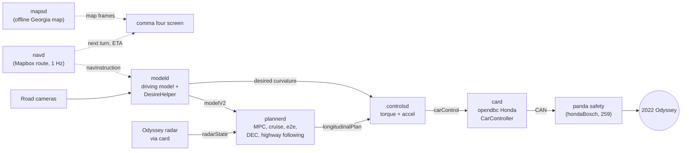
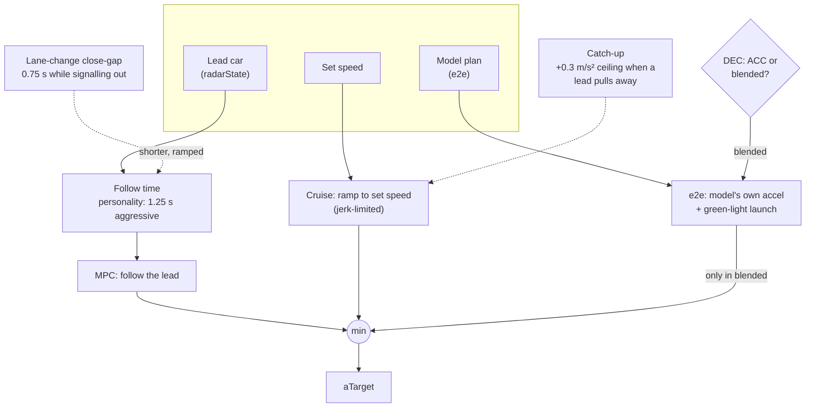
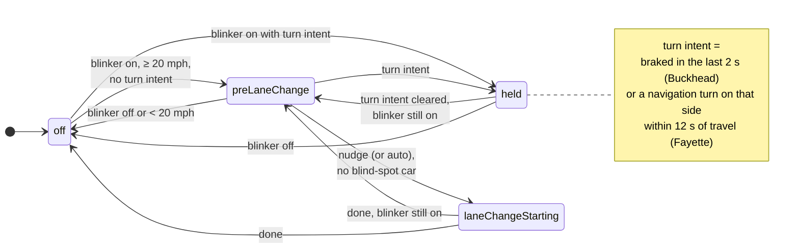
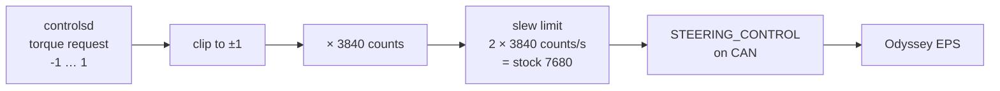
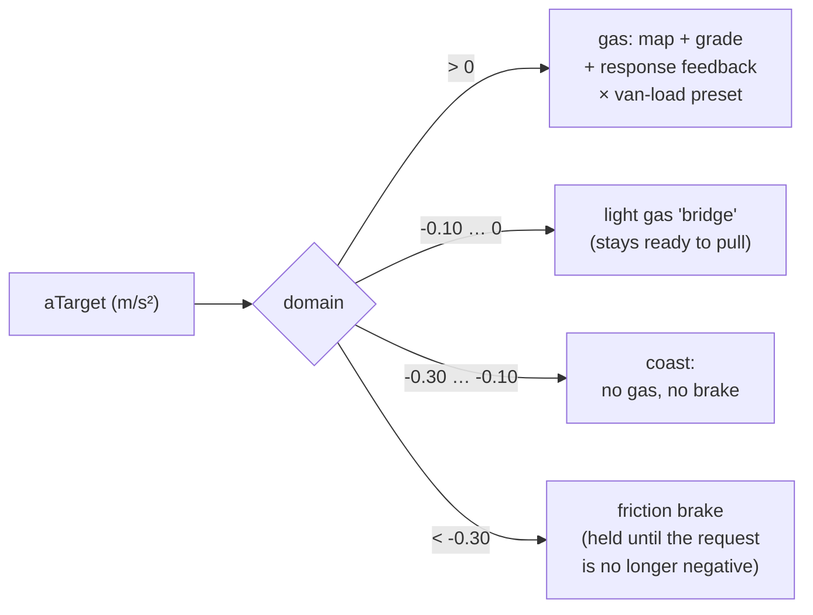

# How RehkopfPilot drives the van

A tour of what happens between the camera and the Odyssey's steering rack, gas and brakes, with the places where this build differs from comma, sunnypilot, MVL and brikowski marked. Diagrams are [Mermaid](https://mermaid.js.org/) and render on GitHub.

## The big picture

mapsd publishes its frames for future navigation-aware driving models; today only the screen reads them. The driving model's only navigation input in this build is the DesireHelper's turn check.

| Piece | Whose code | What this build changes |
|---|---|---|
| Driving model | comma (sunnypilot model store) | nothing |
| DesireHelper (lane changes, turns) | comma + sunnypilot | **turn intent**: braking (Buckhead) or a navigation turn on the blinker side (Fayette) means a turn, not a lane change |
| Planner | comma + sunnypilot (DEC) + MVL | green-light launch (Dahlonega), **lane-change close-gap and catch-up** (Fayette), comma's set-speed fix #39127 |
| Honda CarController | MVL + brikowski | brikowski's Odyssey gas / brake / coast controller, van-load presets, **full 3840 steering range** (Fayette) |
| Panda safety | comma + MVL + brikowski | brikowski's Odyssey longitudinal limits |

## Longitudinal: who gets to decide the acceleration

The planner builds several candidate accelerations and takes the **lowest**. Nothing added in this build can ever ask for more than the most cautious candidate.

- **Dynamic Experimental Control** (sunnypilot) decides whether the model's own acceleration joins the race: "blended" for a stop ahead, slowing traffic, a curve, a standstill or a collision risk, otherwise plain ACC. The comma four shows why in a pill (`STOP AHEAD`, `SLOWING`, `CURVE`, ...).
- **Close-gap** (Fayette, from StarPilot): while the blinker is on for a lane change above 20 mph, the follow time ramps from your personality's gap down to 0.75 s. A car in the blind spot on that side, a lead braking hard, or a stop cancels it.
- **Catch-up** (Fayette, from StarPilot): above 45 mph, below set speed, with a lead in your path that has pulled 0.4-0.7 s beyond the target gap, the cruise candidate may accelerate up to 0.3 m/s² harder. The MPC still holds the gap. With openpilot longitudinal the Odyssey's radar is silenced, so the lead is a vision lead the model is at least 70% sure of. It only matters in ACC mode, because in blended mode the cruise candidate has no ceiling.

## Lane changes and turns

The DesireHelper turns the blinker into a lane change, or deliberately doesn't. Comma's version can't tell a lane change from an intersection turn, so steering into a turn counted as the "nudge" that starts a lane change.

On the 2026-10-23 drives, 4 of 34 lane changes still started in a real turn: taken on the gas, with no braking. The navigation check catches those when you're on a route. Without a route it's still possible, so the prepush check `turn_lane_change` replays every recorded turn to make sure no new build makes it worse.

## Steering

- The Odyssey's camera uses up to **2560** counts for lane keeping. Above that the steering response stops being proportional and the van adds some brake drag (comma's note, from Road Departure Mitigation).
- brikowski's tune rescales `latAccelFactor` (× 1.5) and `friction` (÷ 1.5), so a given lateral acceleration asks for the **same counts** as the stock 2560 range. The extra range only comes into play when the request saturates.
- Atlanta through Etowah opened 2560 → 3840 only between 34 and 74 mph after 0.2 s of missing the curve. On the 2026-10-23 drives the van sat at 2560 about 7% of the time below 55 mph. Fayette follows brikowski's newer `ody-op-test` (cef93020): the full range at every speed.

## Gas and brakes (brikowski's Odyssey controller)

openpilot asks for an acceleration; the Odyssey wants a gas count or a brake command. brikowski's controller decides which domain each request belongs to (`odyssey_command_domains`) and keeps the hand-offs smooth. Above 5 m/s (11 mph):

Below 5 m/s any request at or below zero goes to the brakes, so the van always has stop authority. Gas and brake are never commanded together.

- Grade compensation from the pitch estimate, gas-response feedback that learns how the van answers, and a coast observer.
- Van load (Empty / Family / Family + luggage) scales only the positive gas map input, bounded by the panda's gas limit.
- The actuator delay is 0.5 s, from brikowski's tuning and a fit of my own drives.

## Where to read the code

| Topic | File |
|---|---|
| Turn intent, navigation check | `openpilot/selfdrive/controls/lib/desire_helper.py` |
| Close-gap, catch-up | `openpilot/selfdrive/controls/lib/highway_following.py` |
| Planner candidates | `openpilot/selfdrive/controls/lib/longitudinal_planner.py` |
| DEC | `openpilot/sunnypilot/selfdrive/controls/lib/dec/dec.py` |
| Odyssey car code | `opendbc_repo/opendbc/car/honda/carcontroller.py`, `interface.py`, `values.py` |
| Navigation | `openpilot/selfdrive/navigation/` (see [navigation.md](navigation.md)) |
