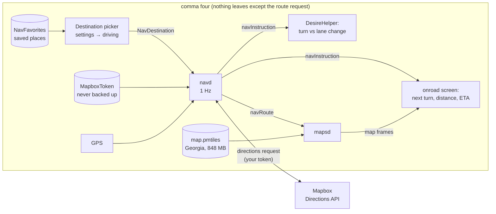
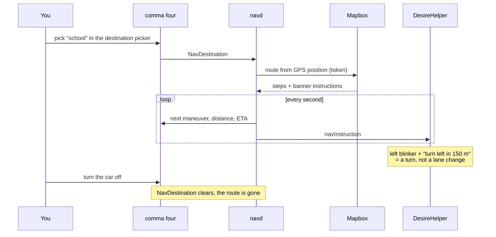

# Navigation without comma prime

comma brought navigation back as "nav alpha" in October 2026 (#39066). Without a prime subscription, comma's servers refuse both the routes and the map tiles. Since Etowah, this build gets them elsewhere: routes from your own Mapbox token, and the map from an offline file on the comma.

## The pieces

| Param | Lifetime | What it holds |
|---|---|---|
| `NavigationEnabled` | persistent | turns navd and mapsd on |
| `MapboxToken` | persistent, **not** in sunnylink backups | your personal Mapbox token (free tier: 100,000 requests a month) |
| `NavFavorites` | persistent, not backed up | saved places, as `[{"name", "latitude", "longitude"}]` |
| `NavDestination` | cleared at every start and when the car turns off | the place you picked for this drive |

## A drive with a route

- navd recomputes when you leave the route, but not while GPS is lost (tunnels).
- Arriving and then driving away clears the destination.
- Keep the phone for traffic rerouting. The comma's route is for openpilot's own awareness: today the turn-vs-lane-change check, later exit slowdowns (roadmap, Gwinnett).

## Privacy

- A failed route request no longer logs the request URL, which carried the token (fixed in Etowah).
- navd logs "Calculating route" without coordinates. Logs upload to comma, and the places are home and family.
- Saved places and the token live only on the comma. Nothing personal is in this repository. The one-time setup script lives in my private notes.

## Setting it up on a new comma

1. Put a Mapbox token on the comma as `MapboxToken`.
2. Put your saved places in `NavFavorites`.
3. Copy an offline map to `/data/navigation/map.pmtiles`. Any [Protomaps](https://protomaps.com) basemap extract works; Georgia at zoom 15 is 848 MB.
4. Turn on `NavigationEnabled`, then pick a destination from settings → driving.
