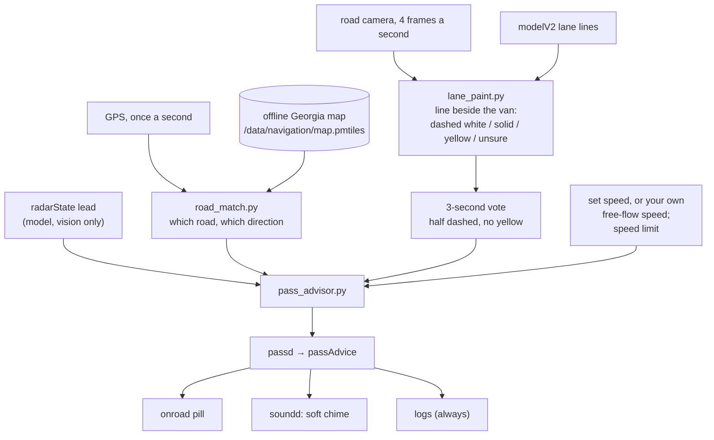

# Pass hints

A blue pill on the comma four (and, if you want, a soft chime) when a slower car has been holding the van back on a divided road and the lane beside you is one you may move into. It is advice only: it never steers, signals or changes speed.

```
 ◀ PASS        a slower car ahead; the lane on the left goes your way
 ◀ PASS ×2     two slow cars in a row ahead
 PASS ▶        opt-in: a slow car camping in the left lane, the lane on the right goes your way
```

**What it can't know.** This Odyssey's blind-spot sensors are not visible to openpilot: their messages are on the van's body bus, which the comma harness doesn't reach, and openpilot (and StarPilot, FrogPilot, dragonpilot, Carrot) only reads Honda blind-spot data on the CR-V's special wiring. The driving model also only reports cars in your own lane. So a hint says nothing about a car beside or behind you, or one ahead in the other lane. You always check mirrors and the lane ahead, exactly as without it.

## How a hint is decided



A hint needs all of these, checked every model frame:

| Condition | Why |
|---|---|
| Matched to a **one-way carriageway** of a motorway / trunk / primary / secondary / tertiary road, not a ramp | OSM maps a divided road as two one-way ways, each drawn in the direction of travel. Matching one, in our direction, means the lane beside us carries traffic our way: never oncoming. |
| The line on that side reads **dashed white** for at least half of the last 3 s, with **no yellow** reading | Dashed white separates lanes going the same way. Yellow is the median edge (or a center line), solid white an edge or a turn bay. One reading can be fooled; a 3-second vote rarely is. |
| A car ahead within 3.5 s, seen with ≥ 70% confidence, for **10 s** | It's really in the way, not passing through. |
| Passing it saves **15 s or more over the next 2 miles** (or up to the next navigation turn) | About 9 mph slower at 70 mph, 5.5 mph at 40. Small gains aren't worth a lane change. |
| With a known speed limit, the car is **5+ mph under it** | When all traffic is slower than you like, the left lane is no faster. |
| 40-90 mph, straight road, no blinker or lane change, no navigation turn within a mile | A calm moment. |

"The speed you want" is your set speed when cruising (RehkopfPilot or stock), otherwise the median of your own free-flowing speed over the last 2 minutes, capped at the speed limit + 7 mph.

It backs off: once per car, never within 90 s of the previous hint, and after 3 hints in a row that you didn't use it shows the pill without the chime for the rest of the drive. A hint goes away after 10 s, or as soon as you signal that way, the car moves off, or the dashed line ends.

## Settings

Driving → **pass hints**: off · **learning** (default) · pill · pill + chime. A separate `PassHintsRight` param turns on right-side hints for left-lane campers (off by default).

**Learning** works everything out and logs it but never shows anything. It runs in factory mode too, so the drives that matter most for tuning (the ones where the van is stock) still count, and nobody ever sees an unchecked hint. Review the logged hints with:

```
python tools/ody/drive_report/pass_hint_review.py ~/rlogs --frames /tmp/hints --ffmpeg <ffmpeg>
```

It lists every hint with its context and, when the road video is pulled (`fcamera.hevc` for full resolution), a strip of frames from 2 s before to 6 s after. Switch to pill or pill + chime once the hints look right.

## What the 2026-10 study found

All pulled drives: 46 routes, 17.9 h (11.8 h above 15 mph), 2026-10-17 to 10-25.

- **Map matching** found a road for 97% of driving above 15 mph. Interstates are 100% one-way carriageways, divided US/state highways 82%.
- **Your left lane changes**: 80 with openpilot's lane-change assist. Looking at 36 of them on video: 1-2 were "stuck behind a slow car" passes; about 12 were interstate lane changes past cars only 1-4 mph slower; about 6 were moves into left-turn lanes; about 2 merges; most of the rest had no car ahead. Of those behind a slower car (38 by the numbers), 76% were on one-way carriageways.
- **The model's road edge** (an early idea for "is there room on the left") was too noisy: it kept 87% of real left lanes but also passed 57% of single-lane ramps. Replaced by the line reading.
- **Line reading**, 24 random frames of the low-res video: no dangerous mistakes, about 40% unsure. But on frames chosen because they read dashed white, **5 of 24 were yellow lines read as white** (shade, and at 10+ m a yellow line is 1-2 px wide in the low-res video with half-resolution color). On the full-resolution camera, which is what the comma reads, 4 of those 5 became yellow or unsure; the fifth (a raised median's yellow edge) still read dashed on that one frame, and the 3-second vote rejects it (2 dashed readings among 11 unsure). The four real dashed lines stayed dashed at full resolution.
- **End to end** on the 9 h of drives with video: **0 hints** at the default sensitivity; 2 at a looser setting (both traffic moving a little under your usual speed). Real "stuck behind a slow car" moments are rare in your driving, so the defaults are quiet on purpose.

## Two slow cars, and left-lane campers

**Two cars.** When the model also sees a second car in your lane within 150 m that is just as slow, the pill says **×2**. Once you are in the left lane the van can't see cars in the right lane, so it can't tell you when you have cleared them; it also never suggests moving back right (yet).

**Left-lane campers.** From the left lane the line on the left reads yellow (median) and the one on the right dashed white. With `PassHintsRight` on, a slow car ahead there gives **PASS ▶**. Off by default: drivers don't expect to be passed on the right, and it is exactly where a blind-spot check matters most.

## Known limits

- **A car beside you or ahead in the other lane.** The hint can't see it (the "rolling roadblock" on route 20: a pickup in each lane at the same speed).
- **Night, rain, heavy shade, worn or no paint.** The line reading mostly says unsure, so no hint. Quiet, not wrong.
- **Two-way roads** (including four-lane undivided ones) never get hints, even with a dashed white line, because in shade a dashed yellow center line can read white. That could change after more full-resolution checks.
- **Roads missing from the offline map, or new construction.** No match, no hint.

## Code

| File | What |
|---|---|
| `selfdrive/controls/lib/pass_advisor.py` | the rules above, pure logic |
| `selfdrive/controls/lib/lane_paint.py` | reading a line from a YUV camera frame, and the 3-second vote |
| `selfdrive/navigation/road_match.py` | GPS + heading → road, one-way or not (uses the existing offline map reader) |
| `selfdrive/controls/passd.py` | the process: camera (VisionIPC) + map + model → `passAdvice`; decides what may show or chime |
| `selfdrive/ui/sunnypilot/mici/onroad/status_pills.py`, `selfdrive/ui/soundd.py` | the pill and the soft chime (`pass_hint.wav`) |
| `tools/ody/drive_report/pass_hint_review.py` | review logged hints with video |
