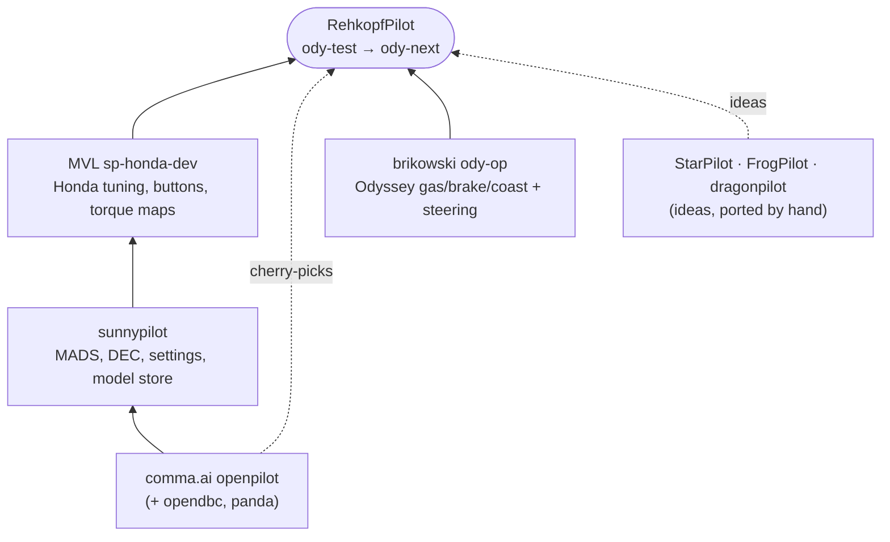
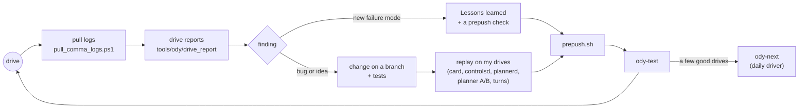
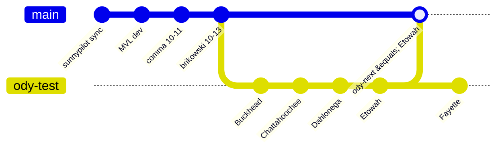
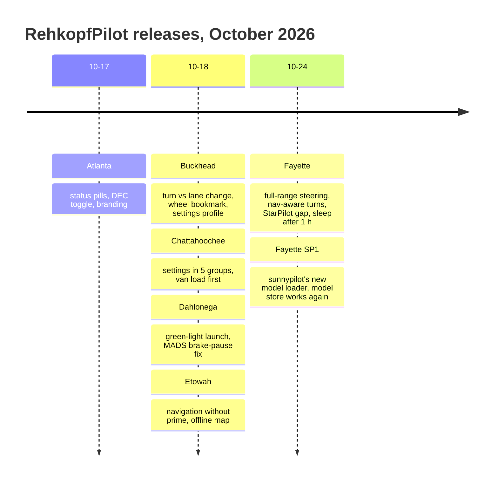
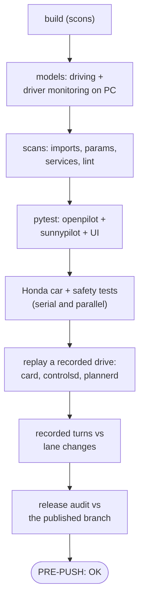

# How a RehkopfPilot release is made

## Where the code comes from

Merge order when updating: sunnypilot sync, then MVL dev, then comma master, then brikowski's Odyssey commits (`tools/ody/README.md`, "Updating from upstream"). Since comma 0.11.3 made Auto-speed permanent and sunnypilot removed Dynamic Experimental Control, upstream changes come in as **cherry-picks**, not whole merges.

## From idea to the van

Every Q/A finding becomes a line in `tools/ody/README.md` → Lessons learned, and a prepush check when it can be one. A new check has to be able to fail: break the thing on purpose once and watch it go red.

## Branches

(`main` stands in for `ody-next` here.) `ody-test` gets each release first. After a few clean drives it is promoted to `ody-next`, the daily driver. The car code lives in [prehkopf/opendbc](https://github.com/prehkopf/opendbc) on branches of the same names, pinned as the `opendbc_repo` submodule.

## Names and versions

Releases are named after places in Georgia, A to Z, and versioned by release date (`YYYY.MM.DD`, `.2`, `.3` for later releases the same day).

A release touches four places:

| File | What |
|---|---|
| `BUILD_NAME` | the codename, shown on the home screen and startup banner |
| `openpilot/sunnypilot/common/version.h` | the release-date version |
| `RELEASE_NOTES.md` | 3-4 lines of at most 30 characters for the comma's "what's new" card |
| `README.md` | the full release notes and the roadmap |

## The prepush checklist

`tools/ody/prepush.sh` runs all of this in a few minutes; `--full` adds opendbc's whole suite and an A/B process replay against a sunnypilot base. Details and the reason for each step are in [`tools/ody/README.md`](../../tools/ody/README.md).
