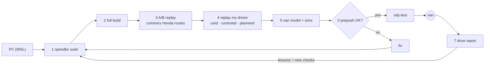
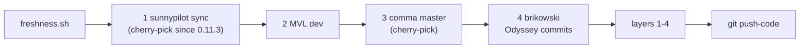

# Odyssey build: how it's tested

Everything here runs on a PC (Ubuntu 24.04, or WSL2 on Windows). Nothing in this folder runs on the comma.
A change goes onto the comma only after every layer below passes. Then it gets a few real drives, and those drives go through the drive report.

| Layer | Script | What it proves |
|---|---|---|
| 0. **Pre-push checklist** | `prepush.sh [--full]` | Runs everything below that fits in a few minutes, plus the checks the layers miss. Required before every push to `ody-next` / `ody-test` |
| 1. opendbc suite | `opendbc_test.sh [branch]` | Panda safety C tests, MISRA, lint, and every car test, including `test_odyssey_port.py` |
| 2. Full build | `build_pc.sh [branch]` | The whole tree compiles. Prints the Honda tuning it builds (delay, ki) |
| 3. A/B replay | `replay_ab.sh [base]` | Replays comma's Honda test routes on a sunnypilot base and on this build. Every difference must trace to a deliberate change |
| 4. Own-route replay | `replay_segments.py <segment>` | card and controlsd from this build run cleanly on my own Odyssey drives |
| 5. Van model + sims | `fit_plant.py`, opendbc `odyssey_load_sim.py` | Closed-loop check of gas changes against a van model fitted from real drives |
| 6. Freshness | `freshness.sh` | How far behind comma, sunnypilot, MVL and brikowski this build is |
| 7. Drive report | `drive_report/` | What actually happened on the road |



## 0. Pre-push checklist

```bash
tools/ody/prepush.sh            # ~90 s: build, models on PC, scans, tests, Honda car + safety, own-drive replay, pins, release bump
tools/ody/prepush.sh --full     # + opendbc's whole suite and the A/B replay
```

What it checks, and why:

- **models:** loads and runs the stock driving model and driver monitoring through their real entry points (`checks/model_e2e.py`). No unit test starts these processes. In October 2026 a tinygrad pin that didn't match comma's model code crashed driver monitoring on the device and blocked onboarding. With that pin put back, this check fails.
- **imports / params / services:** static scans (`checks/`) for imports of modules or names that no longer exist, params keys that aren't registered, and SubMaster/PubMaster services cereal doesn't know. Upstream merges break all three silently.
- **pytest:** openpilot + sunnypilot unit and UI tests. Three locationd/calibrationd scenario tests are deselected because they assert comma's thresholds, which MVL widened on purpose for mount tolerance.
- **locationd_gps:** sunnypilot's `test_params_gps` waits a fixed 5 s for a param, so it runs alone after the parallel step. Prepush first waits up to 60 s for the load average to drop, then retries with a pause. It passes 10/10 on a quiet machine but failed 3 back-to-back retries right after the parallel run.
- **settings_ui:** builds the comma four settings home and every settings group offscreen and renders each onto one wide canvas (`checks/settings_render.py`, PNGs in the prepush log dir). Unit tests never build these pages.
- **honda_car / honda_safety:** opendbc's Honda car tests (including `test_odyssey_port.py`) and panda safety tests.
- **honda_car_parallel:** the same car tests split across workers. The Odyssey `get_params` sets class-level `CarControllerParams` values, so a test can pass serially only because an earlier test built Odyssey params in the same process. A downhill test did exactly that from Atlanta through Buckhead.
- **replay:** card + controlsd + plannerd from this build on a recorded Odyssey segment (`--rlogs DIR`, default `Documents\openpilot\rlogs`). Fails if any of them crashes. (Before Fayette it printed CRASH and still passed.)
- **turn_lane_change:** replays this build's DesireHelper over the 3 newest long recorded drives (`checks/turn_lane_change.py`). Blinker episodes are labelled from what the van did (heading swing over 20 s). Fails if this build starts a lane change in more real turns than the build that drove them, or in fewer than 90% of the real lane changes. Recorded `navInstruction` is fed in when the drive was on a route.
- **pins (informational):** whether our tinygrad contains the pin comma master expects, and how msgq/rednose/panda compare.
- **release_audit:** compares with the published branch (`checks/release_audit.py`). Fails if a params key changed type, and lists every reader of that key. Fails on any commit authored as `root` in openpilot or in the opendbc pin range. Warns about params keys added or removed.
- **release bump (warning):** a push should carry the next codename in `BUILD_NAME` and today's date as the version.

## Setup (once)

```bash
# Windows: wsl --install -d Ubuntu-24.04
curl -LsSf https://astral.sh/uv/install.sh | sh
tools/ody/build_pc.sh ody-next          # clones to ~/odynext and builds (first run ~15 min, rebuilds ~2 min)
cd ~/odynext && source .venv/bin/activate
```

Logs come off the comma with `pull_comma_logs.ps1` on the laptop, which copies `rlog.zst` and `qlog.zst` for every segment into `Documents\openpilot\rlogs\<route>--<seg>\`. The stock uploader only sends qlogs, so full rlogs have to come this way. From WSL that folder is `/mnt/c/Users/<you>/Documents/openpilot/rlogs`.

## 1. opendbc suite

```bash
tools/ody/opendbc_test.sh ody-next      # or ody-test
```

This is opendbc's own `test.sh`, about 10,300 tests. The safety tests need the compiled safety library, so they run on Linux only. Two Odyssey-specific points:

- The MVL Honda controller imports `openpilot.common.params`. `opendbc_shim/` stands in for it so opendbc tests run standalone.
- **Mutation check.** After changing the Odyssey safety limits (`max_gas` 2000, `min_gas` -60, `STEER_MAX` 3840, delta 2), loosen one on purpose and confirm the safety tests fail. Then put it back. This proves the tests actually guard the limits.

## 2. Full build

`build_pc.sh` builds the whole tree (`scons`, about 80 s on a 20-thread laptop) and then runs `check_params.py`, which prints what this build hands the car:

```
HONDA_ODYSSEY_5G_MMR op long: delay 0.5 ...
```

`check_params.py <segment>` also prints what a recorded drive ran with: fork, branch and delay. This is how the delay mismatch was caught. brikowski's controller is tuned at 0.5 s, MVL sets 0.25 s for Bosch, and the Odyssey now stays at 0.5 s.

## 3. A/B process replay

```bash
tools/ody/replay_ab.sh                  # base = sunnypilot master; ody-next was checked against PR #2047 (18aa89b49)
```

This builds the base in `~/spbase`, records its outputs on comma's Honda test routes, and replays this build against them. On ody-next every difference traced to one of three changes:

- MVL Honda tuning: ki 0 on Nidec, Bosch delay 0.25.
- brikowski's `longControlState` ordering fix in controlsd.
- The Odyssey controller.

## 4. Replay on my own drives

```bash
python tools/ody/replay_segments.py ~/rlogs/00000008--83edc4fea4--10
```

This runs card, controlsd and plannerd from this build on a recorded segment. It checks for crashes, valid messages, the fingerprint, the safety param (`hondaBosch` 259), sendcan output, accel compared with what the car actually ran, and the planner's aTarget compared with the logged plan. It exits non-zero on any crash.

For a planner change, compare it with itself switched off on the same segments:

```bash
python tools/ody/drive_report/planner_ab.py ~/rlogs/<route>--60 ~/rlogs/<route>--61   # highway following on vs off
```

Both tools replay with Dynamic Experimental Control on when the recorded drive had it on (replays otherwise start from default params, with DEC off). The two replays share every input, so any difference is the change itself. Comparing one replay with the logged plan mixes in replay drift (around 0.06 m/s² mean even with unchanged code).

**Known quirk:** the replay harness drops a random number of card frames each run (3 to 725 seen, on any branch). Compare values, not message counts.

## 5. Van model and load sims

```bash
python tools/ody/fit_plant.py ~/rlogs/00000007--509a7563e5--* ~/rlogs/00000008--83edc4fea4--*
```

This fits the van's response to the gas command over engaged, pedal-free samples:

`aEgo(t+0.5) = 0.00111·gas + 0.183 − 0.000345·v² − 0.88·g·sin(pitch)`

The fit uses routes 7 and 8 (empty van, rmse 0.11 m/s²), and its best delay is 0.5 s.

On `ody-test`, `opendbc/car/honda/tests/odyssey_load_sim.py` runs the real Honda CarController in closed loop against this model. It covers each true load against each preset setting, over level pull-aways, 4% climbs and cruise.

To calibrate the load presets: run `fit_plant.py` on a loaded drive and compare `c_gas` and `b` with the empty fit. If needed, update `ODYSSEY_LOAD_FACTORS` and the sim's plant.

## 6. Freshness

```bash
tools/ody/freshness.sh
```

This shows how many upstream commits aren't in this build yet, and lists any MVL branches the fork is missing. The fork mirrors all MVL branches so the built-in branch switcher can reach them.

## 7. Drive report

```bash
python tools/ody/drive_report/extract.py ~/rlogs/00000008--83edc4fea4 /tmp/r8.json
python tools/ody/drive_report/engagements.py /tmp/r8.json   # engagements, why each one ended, events, errors
python tools/ody/drive_report/tracking.py /tmp/r8.json      # accel tracking by request band, gas overrides, lateral error by speed, saturation
python tools/ody/drive_report/uphill.py /tmp/r8.json [...]  # shortfall against grade (the known ~0.2 m/s² uphill gap)

# straight from rlogs, any number of routes (route prefix = rlogs/<route>, without the segment number)
python tools/ody/drive_report/steer_cap_report.py ~/rlogs/<route> [...]     # time at the 2560 steering limit / opened to 3840, by speed band
python tools/ody/drive_report/stop_launch_report.py ~/rlogs/<route> [...]  # Brake Hold, op-long stops and launches
python tools/ody/drive_report/launch_eval.py ~/rlogs/<route> [...]         # where the green-light launch fires and what is in front
python tools/ody/drive_report/route_overview.py ~/rlogs/<route> [...]      # one line per route: build, start time, miles, lat/long share, how each engagement ended, alerts
python tools/ody/drive_report/lane_change_check.py ~/rlogs/<route> [...]   # every lane change openpilot started: real lane change or a turn?
```

What to look at after a drive:

- **Long tracking rms.** brikowski ody-op routes ran 0.18 to 0.21.
- **Uphill shortfall.**
- **Steer saturation** and the share of time above 2560 steer counts. From Fayette the full 3840 is available at every speed, so time at 2560 should drop.
- **Lane changes started in turns** (`lane_change_check.py`).
- **Disengage causes.** Brake disengages should be driver choice.
- **Panda TX blocks.** They're benign when they happen only at engage and disengage edges.

## Updating from upstream



1. Run `freshness.sh` to see what's new.
2. Merge, in this order: sunnypilot sync, then MVL dev, then comma master, then brikowski's Odyssey commits.
3. Run layers 1 through 4.
4. Push code only: `GIT_LFS_SKIP_PUSH=1 git push origin <branch>`. In my clone this is the `git push-code` alias. Models come from sunnypilot's Hugging Face store, so they never need to go to GitHub.

## Lessons learned

Add one line each time Q/A finds something new. Turn it into a prepush check when you can.

- **Check submodule pins when taking comma code.** A tinygrad pin that didn't match comma's model code crashed driver monitoring on the device. Covered by `models` and `pins`.
- **Run the processes no unit test starts.** Covered by `models`.
- **After switching branches, run a full `scons`.** Params keys are compiled into `libparams_c.so`, so a stale build fails with UnknownKeyName. Covered by `build`.
- **Run opendbc tests with `PYTHONPATH=$ROOT/opendbc_repo:$ROOT`.** Without it, the venv's installed opendbc is imported and the results mean nothing. Prepush already does this; it matters for hand runs.
- **Tests ported from brikowski can read the wrong constant.** In his tree `CarControllerParams` class values are comma's (gas map floor -0.2). Here they are MVL's (0.0) until the Odyssey `get_params` overwrites them. Ported tests should use the Odyssey constants (`ODYSSEY_GAS_MAP_FLOOR`). Covered by `honda_car_parallel`.
- **Cherry-picks can change a param's type under sunnypilot.** comma #39079 made `LastGPSPosition` binary, and sunnypilot's mapd and map Smart Cruise Control read it as JSON. It was left out of Buckhead SP1. Covered by `release_audit`.
- **Set the git identity in every repo you commit in, including `opendbc_repo`.** Otherwise WSL commits as `root`. Covered by `release_audit`.
- **Timing tests fail under load.** Run them alone after the parallel step, wait for the load to drop, and retry with a pause (`locationd_gps`). Before calling something a regression, alternate 10 runs on old and new commits.
- **Merging comma past sunnypilot's sync can add LFS objects that sunnypilot's store doesn't have.** The 10-12 comma merge brought comma's warp kernels (`big_driving_warp_*_tinygrad.pkl`), and the device installer failed with a 404 on checkout. Those two files are now stored in git. Covered by `lfs_host`.
- **Throwaway worktrees need `GIT_LFS_SKIP_SMUDGE=1`.** Otherwise checkout and cherry-pick fail on LFS files from sunnypilot's Hugging Face store.
- **When upstream changes direction, cherry-pick instead of merging.** comma 0.11.3 makes Auto-speed permanent and sunnypilot removed DEC, so the October 16 sync is not merged whole. Before a pick, read its `params_keys.h` and cereal changes.
- **Settings pages only exist once the UI builds them.** Unit tests didn't catch a crash on first render (a `ui_state` attribute that the UI main loop sets at startup). Covered by `settings_ui`. To review a layout, open the PNGs it writes; scrolled screenshots cut cards in half.
- **Settings card labels fit about 9 characters per line next to the icon.** Longer first lines run into the icon; longer second lines get cut to "...". Check the `settings_ui` renders after renaming anything.
- **The `replay` step re-runs card and controlsd, not the planner.** A planner change (like Dahlonega's green-light launch) gets no replay coverage; run it over recorded drives offline (`drive_report/launch_eval.py`) to see where it fires and what is in front.
- **A turn taken on the gas can start a lane change.** Buckhead's rule needs braking; 4 of 34 lane changes on the 2026-10-23 drives started in a real turn at 45-67 mph with no brake. Fayette adds the navigation check; without a route it is still possible. Covered by `turn_lane_change`.
- **`carState.vCruise` is km/h, not m/s.** A report multiplied it by the m/s-to-mph factor and showed a 74 mph set speed as 268.
- **This openpilot has no `laneChangeFinishing`.** A lane change goes `laneChangeStarting` -> `off` when the model says it is done. Don't count "finished" by that state.
- **Pin the A/B replay base.** `replay_ab.sh` used to fetch sunnypilot `master`. Once that carried comma 0.11.3 (no DEC, a new card API), its own replay crashed and the worker pool hung for 15 minutes. The default base is now pinned (`SP_BASE`, sunnypilot master 2026-10-16); move it deliberately when a sync is taken.
- **Replays start from default params.** DEC is off there, so a planner replay ran plain Experimental mode, where the cruise ceiling doesn't exist, and a catch-up change looked like it did nothing. `recorded_params()` in the replay tools sets what the drive ran.
- **With openpilot longitudinal the Odyssey has no radar leads.** The stock radar is silenced, so every `radarState` lead is vision-only (`radar=False`). Logic gated on `lead.radar` never runs on this van.
- **A replay step that prints CRASH must also exit non-zero.** `replay_segments.py` didn't, so the prepush replay could never fail. Check that a new check can fail: break the thing on purpose once (the turn check fails with the brake rule switched off).
- **Check upstream fixes against your own drives before porting.** Dahlonega dropped two of three candidates that way (stops were already gentle; Brake Hold never turned on). `drive_report/stop_launch_report.py` does that check.
